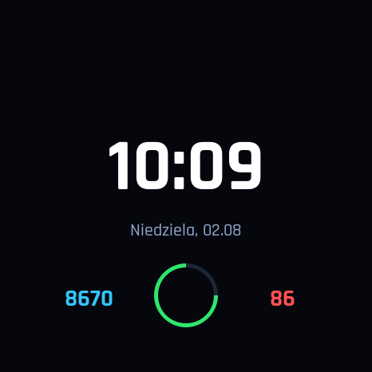
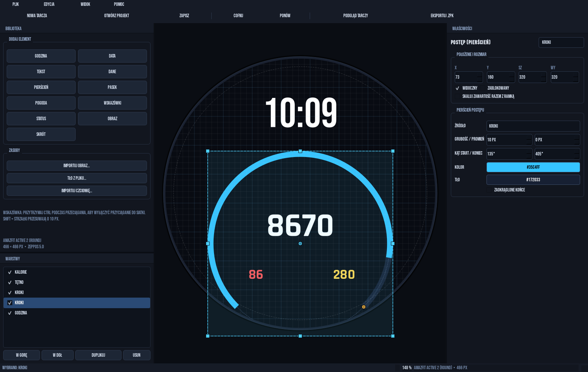
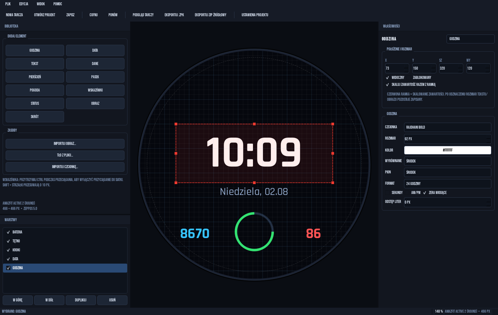

<p align="center">
  
</p>

<h1 align="center">WatchFace Studio</h1>

<p align="center">
  <strong>A graphical watch face editor — compose, preview, and export without writing code.</strong><br>
  Amazfit Active 2 Round · 466×466 · Zepp OS 5
</p>

<p align="center">
  
  
  
  
  
  
  
</p>

<p align="center">
  <sub>🇵🇱 <a href="README.pl.md">Polska wersja README</a></sub>
</p>

> [!WARNING]
> **Target device:** WatchFace Studio is built and tuned exclusively for the **Amazfit Active 2 Round (466×466)**. It has not been tested on other watches. Other Zepp OS models may work, but layout, fonts, hands, and text alignment are not guaranteed.

> [!NOTE]
> **Hobby project, built iteratively with AI assistance.** This is not commercial, audited production code. It was tested where possible, but always check a watch face on your own watch before publishing it.

---

## ✨ What is WatchFace Studio?

WatchFace Studio is a desktop **WYSIWYG** editor for Zepp OS watch faces. Instead of hand-writing `index.js`, you drag elements onto a 466×466 canvas, adjust properties in the side panel, and see the result immediately. Export the finished face as a developer `.zpk` package or as a source ZIP that becomes an everyday watch face.

| | |
|---|---|
| 🖥️ Editor | PySide6, dark UI, canvas 1:1 with the watch screen |
| 🎛️ Elements | 11 types: text, data, weather, hands, rings, shortcuts, and more |
| 👁️ Preview | `F5`, realistic sample data, PNG and animated GIF export |
| 📦 Export | `.zpk` for developer-mode install and a source ZIP for amazfitwatchfaces |
| ⌚ Device | Amazfit Active 2 Round, 466×466, Zepp OS 5.0 / API 4.2 |
| 🧩 Project | Readable `project.json` + `assets/`, no database, no cloud |

---

## ⚡ How it works in 30 seconds

1. 🚀 **Launch the editor** with `run.bat` or `python main.py`.
2. 🧱 **Pick a template** — **Cyfrowa** (Digital), **Minimal**, **Sportowa** (Sport), **Pogodowa** (Weather), or **Pusta** (Empty) — and add the elements you need.
3. 🎨 **Arrange the face** on the canvas: drag, resize with handles, edit properties, and reorder layers.
4. 👁️ **Check the preview** (`F5`), randomize sample values with **Losuj dane** (Randomize data), and save a PNG or GIF.
5. 📦 **Export** (`Ctrl+E` for `.zpk`) or choose **Eksportuj ZIP źródłowy** (Export source ZIP).

```text
project.json + assets/
        │
        ├──▶ render.py ──────▶ 466×466 preview · PNG / GIF
        │
        └──▶ codegen.py ─────▶ app.json · app.js · watchface/index.js · assets/
                    │
                    ▼
              exporter.py ─┬──▶ .zpk  (device.zip + app-side.zip, preview mode)
                           └──▶ source ZIP (flat, production mode)
```

---

## 📸 Screenshots

<p align="center">
  <br>
  <sub><strong>Editor</strong> — 466×466 canvas, element library, properties, and layers in one window.</sub>
</p>

<table>
  <tr>
    <td align="center" width="50%">
      <br>
      <sub><strong>Cyfrowa (Digital) template</strong><br>466×466 preview with sample data</sub>
    </td>
    <td align="center" width="50%">
      <br>
      <sub><strong>Content scaling</strong><br>Red frame = handles also scale the content</sub>
    </td>
  </tr>
</table>

> Screenshots show the interface and demo data. The preview and the package's `Preview.png` are generated by the same renderer.

---

## 🚀 Quick start

### Requirements

- 🪟 Windows 10/11
- 🐍 Python 3.11+ (tested on 3.15)
- 📦 `PySide6-Essentials` and `Pillow` from `requirements.txt`
- ⌚ Amazfit Active 2 Round for on-device testing

### Install and run

```powershell
cd path\to\watchfaceeditor
python -m pip install -r requirements.txt
python main.py
```

Alternatively, double-click **`run.bat`** — it creates `.venv`, installs dependencies whenever they are missing (first launch or an interrupted install), and then starts the editor. If the window closes immediately, run `run.bat` from a terminal to see the message, or delete `.venv` and try again.

### Quick quality check

```powershell
python -m pip install ruff
python -m ruff check wfeditor main.py tools
python -m compileall -q wfeditor main.py tools
```

`ruff` is not an application dependency — it is an optional development tool.

### Installing a watch face on the watch

1. **`Ctrl+E`** creates a `.zpk` file. It is a `preview`-mode package intended for testing and developer-mode installation through the Zepp app.
2. You need Zepp App **6.6.0+**, the same account on the phone and the watch, and an external tool or QR code. **The editor does not generate an installation QR code.**
3. The **final watch face** — visible in the watch face list and removable from the watch — is created from the **source ZIP** uploaded to [amazfitwatchfaces.com](https://amazfitwatchfaces.com/). Only the package returned by that service is intended for normal installation.

> [!IMPORTANT]
> The editor's `.zpk` is not signed and is not intended for distribution. Do not install other people's `.zpk` packages — install only your own builds.

---

## 🧩 Features

| Area | What you get |
|---|---|
| 🧱 Templates | 5 starting points: **Cyfrowa** (Digital), **Minimal**, **Sportowa** (Sport), **Pogodowa** (Weather), **Pusta** (Empty) |
| 🧰 Elements | 11 types: time, date, text, data, ring, bar, weather icon, hands, status, image, shortcut |
| 🕰️ Time display | Type a pattern such as `HH:MM:SS` — show only hours, only minutes, or any combination |
| 📊 Data | 34 sources in 4 groups: Activity, Health, Weather, System |
| 🌤️ Weather | 29 built-in icons, custom sets (a folder with 29 PNGs), temperature, humidity, UV, AQI, pressure, sunrise and sunset |
| 🕰️ Hands | Hour, minute, second, and center cap — each can be replaced individually |
| ⭕ Progress | Ring and bar for 10 sources: steps, calories, distance, heart rate, battery, PAI, standing, stress, SpO₂, sleep — with a curved option and 0%/100% images |
| 🚀 Shortcuts | 61 system and sports apps opened with a tap |
| 🔔 Status | Bluetooth, Do Not Disturb, lock, and active alarm |
| 🔤 Typography | 7 built-in fonts + custom TTF/OTF import |
| 🖱️ Canvas | Dragging, 8 handles, a rotation handle, grid, snapping, undo/redo, duplication, layers, and locking |
| 📐 Scaling | Optional per-widget content scaling with the frame |
| 🎯 Centering | Center horizontally, vertically, or in both axes from the inspector or the canvas context menu |
| 🔄 Rotation | Rotate images, static text, weather icons, shortcuts, and hands with a corner handle (Shift = 15° steps) |
| 🎛️ Preview data | Bottom-right **Dane podglądu** panel: randomize, custom values, time, and weather icon |
| ↔️ Alignment | 9 text alignments (left/center/right × top/middle/bottom); the preview follows the watch's line-box layout, inter-glyph spacing, and ellipsis truncation |
| 🖼️ Images | Premultiplied-alpha scaling — no white fringe and no editor/device mismatch |
| 👁️ Preview | `F5`, random data, PNG export, and 24-frame GIF export |
| 📦 Export | `.zpk` for developer mode and a flat source ZIP for amazfitwatchfaces |
| 🗂️ Project | Name, author, appId (randomized for each new project), version, background, simple AOD screen, image and font import |

### Time display

The **Godzina** (Time) element uses a display pattern instead of separate checkboxes. Type it into the **Wyświetlanie** (Display) field:

| Pattern | Result at 10:09:36 |
| --- | --- |
| `HH:MM` | `10:09` |
| `HH:MM:SS` | `10:09:36` |
| `HH` | `10` (only hours) |
| `MM` | `09` (only minutes) |
| `H:M:S` | `10:9:36` (no leading zeros) |
| `HH.MM` | `10.09` |
| `HH:MM A` | `10:09 AM` |

`HH`, `MM`, and `SS` are zero-padded; `H`, `M`, and `S` are not. `A` adds AM/PM and works with the 12-hour format. Every other character is copied literally, so the separator is up to you. An empty or invalid pattern falls back to `HH:MM`. Projects saved with the old **Sekundy** (Seconds) checkbox are migrated automatically.

### Analog hands

The **Hands** element draws four images: hour, minute, second, and center cap. The element frame defines the area the hands fit into, and its center is the rotation axis.

- A new element defaults to the full screen `(0, 0, 466, 466)`.
- **Dopasuj do tarczy** (Fit to dial) sets the frame to the full screen — the safest option.
- Each hand has its own file picker. A chosen file takes precedence over the set, and **Domyślna** (Default) restores the set setting.
- You can also import a whole folder with `hour.png` and `minute.png` (optionally `second.png` and `cap.png`).
- The built-in set is four 400×400 images with a center pivot. Custom hands should point up and share a square canvas.
- The built-in set in `assets/hands/` is copied into every new project. `tools/make_assets.py` keeps those files and only regenerates them with `--force`.
- Export saves hands as standard `IMG` widgets with `pos_x`/`pos_y`, `center_x`/`center_y`, and `angle` — not as `IMG_POINTER`, which is sometimes ignored on device.
- Each exported hand image is cropped to its visible pixels plus a small transparent margin, and the original position is stored in `pos_x`/`pos_y`. A full-screen 466×466 hand texture takes about 868 KB of decoded RAM; four of them can exceed the watch's memory and cause a reboot. Cropped hands usually take 20–50 KB each and look identical.

### Ring and progress bar

The ring has two canvas dots: the center dot changes the **radius**, and the dot on the arc changes the **thickness**. Dragging left or right also updates the values in the properties panel.

- **Kąt start / koniec** (Start / end angle) sets the arc span. Angles are counted clockwise from 3 o'clock, so `0 → 360` is a full circle and `-10 → 190` starts just above 3 o'clock and sweeps through 6 o'clock to just past 9 o'clock. The exporter converts them to the watch convention (counter-clockwise, 0° = 3 o'clock), so custom angles look on the watch exactly as in the editor.
- **Tło** (Background) is the colour of the unfilled part of the arc. The background is always exported with `level: 100`, so it stays visible when the ring is only partly filled.
- **Pokaż tło** (Show background) hides the background entirely when unchecked; the colour is kept in the project, so the background can be restored with one click.
- The progress itself is sent to the watch with `hmUI.prop.LEVEL`, the same call real watchfaces use, which keeps the arc refreshing reliably.

The progress bar uses the same 10 data sources. Its appearance is configured in the **Pasek postępu** (Progress bar) group:

| Option | Meaning |
| --- | --- |
| **Wygląd** (Appearance) | **Kolor** (solid color) or **Obrazy 0% / 100%** (two images). |
| **Orientacja** (Orientation) | **Poziomo** (horizontal) or **Pionowo** (vertical). |
| **Kształt** (Shape) | **Prosty** (straight) or **Łuk** (arc). |
| **Zakrzywienie** (Curvature) | 0–100% — how strongly the bar bends; 0% is a straight bar. |
| **Grubość** (Thickness) | Arc thickness in px; `auto` derives it from the frame. |
| **Wygięcie** (Bow) | Up/down for horizontal bars, left/right for vertical ones. |
| **Zaokrąglone końce** (Rounded caps) | Rounded ends of the arc. |
| **Wypełnianie** (Fill direction) | **Od początku** (left/bottom) or **Od końca** (right/top). |
| **Pokaż tło** (Show background) | Shows the background of a partly filled bar; uncheck to hide it (the colour stays saved). |

With **Obrazy 0% / 100%**, both images are scaled to the bar frame. The 0% image is the background and the 100% image is revealed gradually with the progress:

- a straight bar clips the 100% image with `pos_x`/`pos_y`,
- a curved bar uses 51 pre-rendered frames (`PROGRESS_BAR_FRAMES`) switched with `hmUI.prop.SRC`, so the watch shows exactly the same picture as the editor.

The arc geometry (center, radius, angles) comes from one shared function (`bar_arc_geometry`) used by the editor, the preview, the frames, and the generated `index.js`. The arc is fitted so the whole band — including rounded caps — stays inside the element frame.

### Content scaling

The **Skaluj zawartość razem z ramką** (Scale content with frame) option works per element:

- ✅ checked — the frame is **red**, and the handles resize text or images; the export receives the same values,
- ⬜ unchecked — only the widget area changes, while the stored text/image size stays the same.

Text scaling uses a single factor for both axes, so letters are not stretched. The preview lays text out the way the watch does: vertical alignment follows the font line box, character spacing is added only between glyphs, and text wider than the frame is truncated with an ellipsis. The generated `index.js` receives the same alignment, spacing, and ellipsis settings.

### Centering and rotation

- The **Wyśrodkuj** (Center) buttons in the properties panel place an element exactly in the middle of the dial: **Poziomo** (horizontal), **Pionowo** (vertical), or **Oba** (both axes). The same options are in the canvas context menu under **Wyśrodkuj na tarczy** (Center on the dial).
- A dashed handle diagonally outside the top-right corner of the selected element rotates it. Hold **Shift** while dragging to snap to 15° steps; the current angle is also shown as **Obrót** (Rotation) in the properties panel and as a label next to the handle.
- Rotation is available for **images, static text, weather icons, shortcuts, and hands**.
- Zepp OS cannot rotate `TEXT` widgets, so static text with rotation is exported as a PNG (`txt_*.png`) plus an `IMG` with `angle` — the watch shows exactly what the editor shows.
- Dynamic text (time, date, data) cannot be rotated; the properties panel shows a hint instead of the angle control.
- Projects saved by older versions stored the image angle in `props["angle"]`; it is migrated automatically to the common rotation.
- A rotated element can still be selected by clicking its visible (rotated) content.

### Preview data panel

The **Dane podglądu** (Preview data) dock in the bottom-right corner controls what the canvas shows without a watch:

- **Losuj dane** (Randomize data) fills every data field, the time, and the weather icon with random values — the canvas updates immediately.
- **Wyczyść** (Clear) restores the default sample values.
- **Godzina** (Time) overrides the time used by the preview; leaving it empty (shown as `00:00:00`) means no override.
- **Ikona pogody** (Weather icon) selects one of the 29 built-in weather icons.
- **Własne wartości** (Custom values) lists only the data sources used by the project. Type values such as `8670`, `5,3 km`, or `07:32` and they appear on the canvas.
- The same values are passed to the `F5` preview dialog. The panel can be hidden from the **Widok** (View) menu.

### Fonts and Polish glyphs

The editor registers the exact font file, reads its family, style, and weight through `QRawFont`, and draws text with that face. As a result, **Regular**, **Medium**, and **Bold** look the same in the editor, preview, and on the watch. The built-in fonts include a full set of Polish glyphs; when importing a custom TTF/OTF, make sure it contains the required characters.

---

## 🧠 How does it work?

The editor is split into layers: the project model, renderer, code generator, and exporter. Each layer uses the same input data, so the preview and the package do not drift apart.

### 1. Project model

`wfeditor/model.py` stores `Project` and `Element` as dataclasses. A project is saved to `project.json`, while images and fonts go into `assets/`. The undo/redo history lives in memory only — it is not saved to disk.

A new, unsaved watch face goes temporarily to `%TEMP%\WatchFaceStudio\projects`. On **Zapisz jako** (Save As), the editor proposes the repo's `projects/` directory, but you can choose any location. The `projects/` directory is ignored by git.

### 2. Renderer

`wfeditor/render.py` draws the watch face with `QPainter` in a logical 466×466 layout. The same renderer powers:

- the editor canvas and the `F5` preview,
- the package's `Preview.png`,
- PNG and GIF export.

The preview scales the whole image while preserving proportions, not individual elements — so the layout is identical regardless of window size. The renderer also handles sample data, random values, and weather icon substitution.

### 3. Code generator

`wfeditor/codegen.py` turns the project into Zepp OS files:

- `app.json` — device configuration, `designWidth`, permissions, and `packageInfo`,
- `app.js` — application bootstrap,
- `watchface/index.js` — widgets, sensors, weather timer, hands, and AOD logic.

The `gps` permission is added only when the watch face uses weather: a weather icon or data from the Weather group (city, temperature, humidity, etc.). The generator does not add network permissions.

### 4. Resources

`wfeditor/resources.py` plans what goes into `device/assets/`: element images, weather and status icons, fonts, and hand assets. File names are generated from the source and size, so exports are repeatable. Shortcut icons get a shared transparent `empty.png` when needed.

### 5. Images and alpha

`wfeditor/imaging.py` loads, scales, and saves images in **premultiplied alpha** space. Downscaling uses a mipmap chain (no aliasing) and upscaling uses sharp-bilinear resampling (integer nearest enlargement followed by a smooth resize). Neither blends color with a transparent background, so no white fringe appears on the edges and details stay sharp. The same pipeline is used by the editor and when building the package.

### 6. Exporter

`wfeditor/exporter.py` builds the `device/` tree and then:

- **`.zpk`** — packages `device.zip` and `app-side.zip`, sets `mode: "preview"` and `lockscreen: 1`,
- **source ZIP** — packages the contents of `device/` without a subfolder, sets `mode: "production"` and `lockscreen: 0`.

Both variants include a 314×314 `Preview.png`, the size expected by the watch face list.

---

## 📦 What goes into the export

| | `.zpk` (dev) | Source ZIP |
|---|---|---|
| Purpose | Testing and developer-mode installation | amazfitwatchfaces → production watch face |
| Layout | `device.zip` + `app-side.zip` | Flat contents of `device/` (no subfolder) |
| `app.json` | `mode: "preview"`, `lockscreen: 1` | `mode: "production"`, `lockscreen: 0` |
| Platform | `Amazfit Active 2` | `Amazfit Active 2` |
| `watchface/index.js` | ✅ | ✅ |
| Images and fonts | ✅ | ✅ |
| `Preview.png` 314×314 | ✅ | ✅ |
| `app-side/app.json` | ✅ | ❌ |
| Weather / GPS | only when weather is used | only when weather is used |

---

## ⌨️ Keyboard shortcuts

| Shortcut | Action |
|---|---|
| `Ctrl+N` | New watch face |
| `Ctrl+O` | Open project |
| `Ctrl+S` | Save |
| `Ctrl+Shift+S` | Save as |
| `Ctrl+E` | Export `.zpk` |
| `F5` | Watch face preview |
| `Ctrl+Z` / `Ctrl+Y` | Undo / redo |
| `Ctrl+D` | Duplicate element |
| `Delete` | Delete selected element |
| `Shift` + arrow keys | Move by 10 px |
| `Ctrl` + drag | Temporarily disable grid snapping |

---

## 🧰 Tech stack

| Layer | Technology | Role |
|---|---|---|
| Language | Python 3.11+ | Editor and export logic |
| UI | PySide6-Essentials / Qt 6 | Windows, panels, canvas, dialogs |
| Rendering | `QPainter`, `QRawFont` | Preview, text, hands, rings |
| Images | Pillow + Qt | Premultiplied-alpha scaling, PNG, GIF |
| Model | JSON + dataclasses | `project.json`, elements, settings |
| Export | `zipfile`, `tempfile` | `.zpk` and source ZIP |
| Platform | Zepp OS 5 / API 4.2 | `hmUI`, `hmSensor`, `DeviceRuntimeCore.WatchFace` |
| Tests | External Node harness + PySide6 scripts | `index.js` runtime, UI, render, export (outside the repo) |

---

## 🗂️ Repository structure

```text
.
├── main.py                      # application entry point
├── run.bat                      # Windows: venv + dependencies + launch
├── requirements.txt             # PySide6-Essentials, Pillow
├── README.md                    # English README
├── README.pl.md                 # Polish README
├── images/                      # README screenshots
├── assets/
│   ├── fonts/                   # 7 built-in TTF fonts
│   ├── hands/                   # hour/minute/second/cap 400×400
│   ├── status/                  # Bluetooth, DND, lock, alarm icons
│   └── weather/                 # 29 weather icons
├── tools/
│   └── make_assets.py           # built-in asset generator
├── wfeditor/
│   ├── main.py                  # QApplication, theme, first project
│   ├── constants.py             # device, data, weather, shortcuts, fonts
│   ├── model.py                 # Project, Element, templates, asset import
│   ├── timeformat.py            # HH:MM:SS time pattern parser and renderer
│   ├── render.py                # preview, text, hands, GIF
│   ├── codegen.py               # app.json, app.js, watchface/index.js
│   ├── resources.py             # package asset plan
│   ├── imaging.py               # premultiplied alpha
│   ├── exporter.py              # .zpk and source ZIP
│   ├── templates/
│   │   └── app.js               # Zepp OS bootstrap
│   └── ui/
│       ├── mainwindow.py        # menus, bars, export, shortcuts
│       ├── canvas.py            # canvas, handles, grid, ring
│       ├── inspector.py         # element properties
│       ├── layers.py            # layer list
│       ├── palette.py           # add elements and assets
│       ├── dialogs.py           # new project, settings, preview
│       └── theme.py             # dark Qt theme
├── projects/                    # user projects (gitignored)
└── .gitignore
```

---

## 🧪 Tests

The repository has **no test directory** — during development I used an external harness and scripts run from `%TEMP%`. They are not part of the repository, so the results below describe the latest state of work, not a finished CI pipeline.

```powershell
python -m ruff check wfeditor main.py tools
python -m compileall -q wfeditor main.py tools
```

Covered:

- ✅ **33/33** Node harness checks executing the generated `index.js`: weather, hands, fonts, and asset existence,
- ✅ structure and manifests of `app.json`/`app.js` and the `.zpk` and source ZIP packages,
- ✅ templates, adding and duplicating elements, layers, undo/redo,
- ✅ hands: per-role selection, file-over-set precedence, **Domyślna** (Default), fit to dial,
- ✅ ring: radius and thickness dragging, synchronization with the fields,
- ✅ content scaling and export of the same values,
- ✅ 3×3 text alignment, Polish glyphs, Regular/Medium/Bold,
- ✅ time patterns: `HH`, `MM`, `HH:MM`, `HH:MM:SS`, `H:M:S`, `HH.MM`, `HH:MM A`, 12/24h, migration of old `seconds`/`ampm`/`pad` props, and identical editor/export output,
- ✅ random project `appId` for every new project,
- ✅ two weather elements with the same and with different icon sets,
- ✅ PNG/GIF preview with random data,
- ✅ `.zpk` structure, `preview` mode, `lockscreen: 1`, hand assets cropped to visible content, `center_x: 233`, no `IMG_POINTER`,
- ✅ source ZIP: flat layout, `mode: "production"`, platform `Amazfit Active 2`.

Not covered:

- ❌ CI and tests in the repository,
- ❌ visual regression tests,
- ❌ full confirmation on a physical watch: hand movement, watch face list position, trash icon, and full alignment parity,
- ❌ testing on other watch models.

---

## 🛠️ Limitations and trade-offs

1. **One device.** The entire layout is designed for 466×466. `designWidth` is fixed, and other resolutions require separate profiles and testing.
2. **No image-based digits.** Time and date are drawn with a font, not a set of `0–9` images. This simplifies the editor but limits styling.
3. **Simplified AOD.** Project settings let you choose a color and time for the always-on display; this is not a full, independent AOD layout.
4. **Weather before sync.** The city name shows `--` and the icon uses the "unknown" variant until the watch fetches data.
5. **Hands need a well-positioned frame.** The rotation axis is the frame center, and the set is scaled to fit inside it. The frame should be square and centered on the dial; otherwise the hands will be smaller or the axis will not match the dial — use **Dopasuj do tarczy** (Fit to dial).
6. **Custom fonts may lack required glyphs.** The editor warns about missing Polish characters but does not repair them.
7. **`.zpk` is developer mode.** The final, removable watch face is created only from the source ZIP on amazfitwatchfaces.
8. **Not everything confirmed on hardware.** Hands as `IMG`, the watch face list and trash icon fixes, and text alignment were checked in code, preview, and exported files — but not every one of these was confirmed on a physical watch.
9. **Tests outside the repo, no CI.** Quality relies on the harness, temporary scripts, and manual checks, not a repeatable pipeline.
10. **No `LICENSE` file.** Add a license of your choice before publishing as open source.

---

## 🔒 Security & privacy

- 🚫 The desktop app sends no data over the network and includes no telemetry.
- 💾 Projects, images, and fonts stay local — in `project.json` and `assets/`.
- 🔐 The repo contains no accounts, tokens, or Zepp/Amazfit credentials.
- 📡 The generated `app.json` adds no network permissions. The only conditional permission is `gps`, needed for weather: icons or weather data.
- ⚠️ **`.zpk` packages are not signed.** Install only your own builds and only in developer mode.
- 🧪 Imported images and fonts are copied into the project — make sure they come from a trusted source before importing.

---

## 🗺️ Roadmap

- [ ] Confirm hand movement, watch face list, trash icon, and text alignment on a physical watch
- [ ] Add tests to the repository and a simple CI pipeline
- [ ] Add another watch profile only after hardware testing
- [ ] Add a full, independent AOD layout
- [ ] Add image-based digits
- [ ] Add more hand and weather icon sets
- [ ] Add a short demo GIF to the README
- [ ] Add a `LICENSE` file

---

## 📄 License

There is no `LICENSE` file in the repository. If you want to publish this as open source, add a license of your choice — for example, MIT.

---

## 🙏 Credits

- [Qt for Python / PySide6](https://doc.qt.io/qtforpython/) — UI and renderer
- [Pillow](https://python-pillow.org/) — images and GIF
- [Zepp OS Developers Documentation](https://docs.zepp.com/) — watch face and device APIs
- The [amazfitwatchfaces.com](https://amazfitwatchfaces.com/) community — package format and watch face publishing
- Built-in fonts: Rajdhani, Chakra Petch, Michroma, Bebas Neue
- AI as a partner in the iterative development of this project

---

## ⚠️ Disclaimer

Hobby project, not affiliated with Zepp Health or Amazfit. Built exclusively for the **Amazfit Active 2 Round (466×466)** and not tested on other watches. Use at your own risk. Before publishing or using a watch face daily, check its appearance, hand movement, and installation on your own device.
