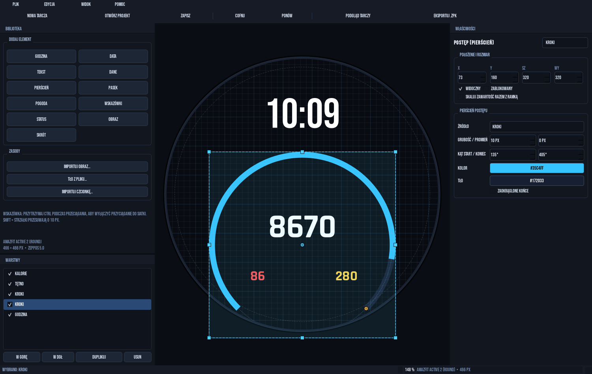
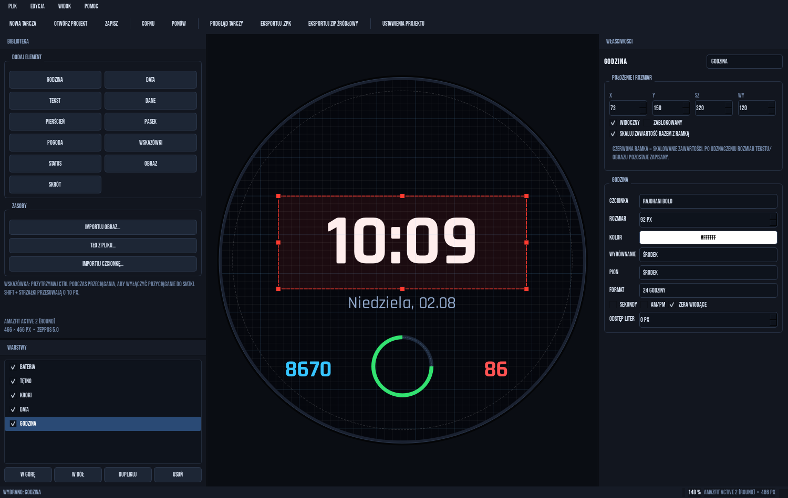

  

<h1 align="center">WatchFace Studio</h1>

  <strong>Visual watch face editor — design, preview, and export a watch face without writing code.</strong> 
  Amazfit Active 2 Round · 466×466 · Zepp OS 5

  
  
  
  
  
  
  

    [!WARNING]
    Target device: WatchFace Studio is built and optimized exclusively for the Amazfit Active 2 Round (466×466). It has not been tested on other watches. Other Zepp OS models may work, but layout, fonts, hands, and text alignment are not guaranteed.

    [!NOTE]
    A hobby project developed iteratively with AI assistance. This is not a commercial or audited product. The code has been tested wherever possible, but always check your watch face on your own device before publishing it.

✨ What is WatchFace Studio?

WatchFace Studio is a desktop WYSIWYG editor for Zepp OS watch faces. Instead of manually writing index.js, you drag elements onto a 466×466 canvas, configure their properties in the adjacent panel, and see the result immediately. You can export the finished watch face as a developer .zpk package or as a source ZIP, which can be used to create a watch face for everyday use.
	
🖥️ Editor	PySide6, dark interface, canvas matching the watch screen at a 1:1 scale

🎛️ Elements	11 types: text, data, weather, hands, rings, shortcuts, and more

👁️ Preview	F5 mode, realistic sample data, PNG and animated GIF export

📦 Export	.zpk for developer installation and a source ZIP for amazfitwatchfaces

⌚ Device	Amazfit Active 2 Round, 466×466, Zepp OS 5.0 / API 4.2

🧩 Project	Readable project.json + assets/ folder, with no database or cloud

⚡ How it works in 30 seconds

    🚀 Launch the editor using run.bat or python main.py.
    🧱 Choose a template — Digital, Minimal, Sport, Weather, or Blank — and add the elements you need.
    🎨 Arrange the watch face on the canvas: drag elements, resize them using the handles, configure properties, and change the layer order.
    👁️ Check the preview (F5), generate sample data using the Randomize data button, and save a PNG or GIF.
    📦 Export (Ctrl+E for .zpk) or choose Export source ZIP.

text

project.json + assets/
        │
        ├──▶ render.py ──────▶ 466×466 preview · PNG / GIF
        │
        └──▶ codegen.py ─────▶ app.json · app.js · watchface/index.js · assets/
                    │
                    ▼
              exporter.py ─┬──▶ .zpk  (device.zip + app-side.zip, preview mode)
                           └──▶ source ZIP (flat, production mode)

📸 Screenshots

   
  <strong>Editor</strong> — 466×466 canvas, element library, properties, and layers in one window.

<table>
  <tr>
    <td align="center" width="50%">
       
      <strong>Digital template</strong> 466×466 preview with sample data
    </td>
    <td align="center" width="50%">
       
      <strong>Content scaling</strong> Red outline = handles also scale the content
    </td>
  </tr>
</table>

    The screenshots show the interface and demonstration data. The preview and Preview.png in the package are generated by the same renderer.

🚀 Quick start
Requirements

    🪟 Windows 10/11
    🐍 Python 3.11+ (tested with 3.15)
    📦 PySide6-Essentials and Pillow from requirements.txt
    ⌚ Amazfit Active 2 Round for on-device testing

Installation and launch
powershell

cd path\to\watchfaceeditor
python -m pip install -r requirements.txt
python main.py

Alternatively, double-click run.bat. On the first launch, it creates a .venv, installs the dependencies, and then starts the editor.
Quick quality check
powershell

python -m pip install ruff
python -m ruff check wfeditor main.py tools
python -m compileall -q wfeditor main.py tools

ruff is not an application dependency. It is an optional development tool.
Installing a watch face on the watch

    Ctrl+E creates a .zpk file. This is a package in preview mode intended for testing and installation through the Zepp developer app.
    Installation requires Zepp App 6.6.0+, the same account on your phone and watch, and an external tool or QR code. The editor does not generate an installation QR code.
    The final watch face — visible in the watch face list and removable from the watch — is created from the source ZIP uploaded to amazfitwatchfaces.com. Only the package returned by this service is intended for normal installation.

    [!IMPORTANT]
    The .zpk generated by the editor is unsigned and is not intended for distribution. Do not install third-party .zpk packages — only install your own builds.

🧩 Features
Area	What you get
🧱 Templates	5 starting points: Digital, Minimal, Sport, Weather, Blank
🧰 Elements	11 types: time, date, text, data, ring, bar, weather icon, hands, status, image, shortcut
📊 Data	34 data sources in 4 groups: Activity, Health, Weather, System
🌤️ Weather	29 built-in icons, custom icon sets (a folder containing 29 PNG files), temperature, humidity, UV, AQI, pressure, sunrise, and sunset
🕰️ Hands	Hour, minute, and second hands, plus a center cap — each can be replaced independently
⭕ Progress	Ring and bar for 10 data sources: steps, calories, distance, heart rate, battery, PAI, standing, stress, SpO₂, sleep
🚀 Shortcuts	61 system and sports apps that open when tapped
🔔 Status	Bluetooth, Do Not Disturb, lock, and active alarm
🔤 Typography	7 built-in fonts + custom TTF/OTF import
🖱️ Canvas	Dragging, 8 handles, grid, snapping, undo/redo, duplication, layers, and locking
📐 Scaling	Optional scaling of content together with its frame, configurable for each widget
↔️ Alignment	9 text alignment settings (left/center/right × top/middle/bottom), consistent between the editor and export
🖼️ Images	Scaling in premultiplied-alpha space — no white fringes and no differences between the editor and device
👁️ Preview	F5, randomized data, PNG export, and 24-frame GIF export
📦 Export	.zpk for developer mode and a flat source ZIP for amazfitwatchfaces
🗂️ Project	Name, author, appId, version, background, simple AOD screen, image and font import
Analog hands

The Hands element renders four images: hour hand, minute hand, second hand, and center cap. The frame defines the area occupied by the hands, and the rotation axis is at the center of that frame.

    A new element occupies the entire screen by default: (0, 0, 466, 466).
    The Fit to watch face button sets the frame to the full screen — this is the safest option.
    Each hand has its own file selector. A selected file takes priority over the set, while Default restores the set's default setting.
    You can also import an entire folder containing hour.png and minute.png, with second.png and cap.png as optional files.
    The built-in set consists of four 400×400 images with the rotation axis at the center. Custom hands should point upward and share the same square canvas size.
    Export saves the hands as standard IMG widgets with pos_x/pos_y, center_x/center_y, and angle — not as IMG_POINTER, which may be ignored on the device.

Ring and progress bar

The ring has two control points on the canvas: the center point changes the radius, while the point on the arc changes the thickness. Dragging left or right also updates the values in the properties panel. The progress bar uses the same data sources and displays the fill percentage.
Content scaling

The Scale content with frame option works independently for each element:

    ✅ Enabled — the frame is red, and the handles resize the text or image; the exported package receives the same values.
    ⬜ Disabled — only the widget area changes, while the saved text/image size remains unchanged.

Text scaling uses a single factor for both axes, so the letters are not stretched. Horizontal and vertical alignment are calculated consistently in the editor, preview, and generated index.js.
Fonts and Polish characters

The editor registers the exact font file, reads its family, style, and weight through QRawFont, and renders text using the specified typeface. This ensures that Regular, Medium, and Bold look the same in the editor, preview, and on the watch. The built-in fonts support the full set of Polish characters. When importing your own TTF/OTF, check that it contains the required glyphs.
🧠 How does it work?

The editor is divided into layers: the project model, renderer, code generator, and exporter. Each uses the same input data, preventing discrepancies between the preview and the exported package.
1. Project model

wfeditor/model.py stores Project and Element as dataclasses. The project is saved to project.json, while images and fonts are stored in assets/. The change history (undo/redo) exists only in memory and is not saved to the file.

A new, unsaved watch face is temporarily stored in %TEMP%\WatchFaceStudio\projects. When using Save As, the editor suggests the projects/ directory in the repository, but you can choose any location. The projects/ directory is ignored by git.
2. Renderer

wfeditor/render.py renders the watch face using QPainter in a logical 466×466 layout. The same renderer handles:

    The editor canvas and F5 preview.
    The Preview.png image in the package.
    PNG export and animated GIF export.

The preview scales the entire composition while preserving its proportions, rather than scaling individual elements separately. This keeps the layout identical regardless of the window size. The renderer also supports sample data, randomized values, and weather icon replacement.
3. Code generator

wfeditor/codegen.py converts the project into Zepp OS files:

    app.json — device configuration, designWidth, permissions, and packageInfo.
    app.js — application bootstrap.
    watchface/index.js — widgets, sensors, weather timer, hands, and AOD logic.

The gps permission is added only when the watch face uses weather features: a weather icon or data from the Weather group (city, temperature, humidity, etc.). The generator does not add network permissions.
4. Resources

wfeditor/resources.py determines which resources go into device/assets/: element images, weather and status icons, fonts, and hand assets. File names are generated from the source and size, making exports reproducible. Shortcut icons receive a shared transparent empty.png when needed.
5. Images and alpha

wfeditor/imaging.py loads, scales, and saves images in premultiplied-alpha space. Resizing does not mix colors with transparent backgrounds, preventing white fringes from appearing along edges. The same pipeline is used in the editor and when building the package.
6. Exporter

wfeditor/exporter.py builds the device/ directory tree and then:

    .zpk — packages device.zip and app-side.zip, sets mode: "preview" and lockscreen: 1.
    Source ZIP — packages the contents of device/ without the parent directory, sets mode: "production" and lockscreen: 0.

Both variants include Preview.png at 314×314, the size expected by the watch face list.
📦 What goes into the export
	.zpk (dev)	Source ZIP
Purpose	Testing and installation in developer mode	amazfitwatchfaces → production watch face
Structure	device.zip + app-side.zip	Flat contents of device/ (without a parent directory)
app.json	mode: "preview", lockscreen: 1	mode: "production", lockscreen: 0
Platform	Amazfit Active 2	Amazfit Active 2
watchface/index.js	✅	✅
Images and fonts	✅	✅
Preview.png 314×314	✅	✅
app-side/app.json	✅	❌
Weather / GPS	Only when weather is used	Only when weather is used
⌨️ Keyboard shortcuts
Shortcut	Action
Ctrl+N	New watch face
Ctrl+O	Open project
Ctrl+S	Save
Ctrl+Shift+S	Save As
Ctrl+E	Export .zpk
F5	Preview watch face
Ctrl+Z / Ctrl+Y	Undo / redo
Ctrl+D	Duplicate element
Delete	Delete selected element
Shift + arrow keys	Move by 10 px
Ctrl + dragging	Temporarily disable grid snapping
🧰 Technologies
Layer	Technology	Role
Language	Python 3.11+	Editor and export logic
Interface	PySide6-Essentials / Qt 6	Windows, panels, canvas, dialogs
Rendering	QPainter, QRawFont	Preview, text, hands, rings
Images	Pillow + Qt	Premultiplied-alpha scaling, PNG, GIF
Model	JSON + dataclasses	project.json, elements, settings
Export	zipfile, tempfile	.zpk and source ZIP
Platform	Zepp OS 5 / API 4.2	hmUI, hmSensor, DeviceRuntimeCore.WatchFace
Tests	External Node harness + PySide6 scripts	Runtime index.js, UI, rendering, export (outside the repository)
🗂️ Repository structure
text

.
├── main.py                      # application entry point
├── run.bat                      # Windows: venv + dependencies + launch
├── requirements.txt             # PySide6-Essentials, Pillow
├── README.md
├── images/                      # screenshots for README
├── assets/
│   ├── fonts/                   # 7 built-in TTF fonts
│   ├── hands/                   # hour/minute/second/cap 400×400
│   ├── status/                  # Bluetooth, DND, lock, alarm icons
│   └── weather/                 # 29 weather icons
├── tools/
│   └── make_assets.py           # built-in asset generator
├── wfeditor/
│   ├── main.py                  # QApplication, theme, initial project
│   ├── constants.py             # device, data, weather, shortcuts, fonts
│   ├── model.py                 # Project, Element, templates, asset import
│   ├── render.py                # preview, text, hands, GIF
│   ├── codegen.py               # app.json, app.js, watchface/index.js
│   ├── resources.py             # package resource planning
│   ├── imaging.py               # premultiplied alpha
│   ├── exporter.py              # .zpk and source ZIP
│   ├── templates/
│   │   └── app.js               # Zepp OS bootstrap
│   └── ui/
│       ├── mainwindow.py        # menus, toolbars, export, shortcuts
│       ├── canvas.py            # canvas, handles, grid, ring
│       ├── inspector.py         # element properties
│       ├── layers.py            # layer list
│       ├── palette.py           # adding elements and assets
│       ├── dialogs.py           # new project, settings, preview
│       └── theme.py             # Qt dark theme
├── projects/                    # user projects (gitignored)
└── .gitignore

🧪 Tests

The repository does not contain a test directory. During development, an external harness and scripts running in %TEMP% were used. They are not part of the repository, so the results below describe the latest development state rather than a complete CI pipeline.
powershell

python -m ruff check wfeditor main.py tools
python -m compileall -q wfeditor main.py tools

Areas checked:

    ✅ 31/31 checks in the Node harness running the generated index.js: weather, hands, fonts, and resource existence.
    ✅ Structure and manifests for app.json/app.js, .zpk packages, and source ZIPs.
    ✅ Templates, adding and duplicating elements, layers, undo/redo.
    ✅ Hands: per-role selection, file priority over set defaults, Default, fit to watch face.
    ✅ Ring: dragging radius and thickness, synchronizing values with fields.
    ✅ Content scaling and exporting the same values.
    ✅ 3×3 text alignment, Polish characters, Regular/Medium/Bold.
    ✅ Two weather elements using the same or different icon sets.
    ✅ PNG/GIF preview with randomized data.
    ✅ .zpk structure, preview mode, lockscreen: 1, four 466×466 hand assets, center_x: 233, no IMG_POINTER.
    ✅ Source ZIP: flat structure, mode: "production", Amazfit Active 2 platform.

What is not included:

    ❌ CI and tests in the repository.
    ❌ Visual regression tests.
    ❌ Full verification on a physical watch: hand movement, position in the watch face list, delete icon, and complete text alignment compatibility.
    ❌ Testing on other watch models.

🛠️ Limitations and deliberate trade-offs

    One device. The entire layout is designed for 466×466. designWidth is fixed, and other resolutions require separate profiles and testing.
    No image-based digits. Time and date are rendered using fonts rather than sets of digit images 0–9. This simplifies the editor but limits styling options.
    Simplified AOD. Project settings let you choose the color and time for the always-on display, but this is not a complete, independent AOD layout.
    Weather before synchronization. The city name displays -- and the icon uses the "unknown" variant until the watch retrieves weather data.
    Hands require a correctly positioned frame. Rotation is calculated relative to the center of the frame, and the set is scaled to fit inside it. The frame should be square and centered on the watch face; otherwise, the hands may be smaller or the pivot may not align with the center. Use Fit to watch face.
    Custom fonts may lack Polish characters. The editor warns about this but does not fix missing glyphs.
    .zpk is for developer mode. The final, removable watch face is created only after the source ZIP is processed by amazfitwatchfaces.
    Not everything has been verified on hardware. Hands implemented as IMG, watch face list and delete icon fixes, and text alignment have been checked in the code, preview, and exported files — but not every feature has been verified on a physical watch.
    Tests are outside the repository; no CI. Quality assurance relies on the harness, temporary scripts, and manual checks rather than a repeatable pipeline.
    No LICENSE file. Before publishing the project as open source, add your chosen license.

🔒 Security and privacy

    🚫 The desktop application does not send data over the network and contains no telemetry.
    💾 Projects, images, and fonts remain local — in project.json and assets/.
    🔐 The repository contains no accounts, tokens, or Zepp/Amazfit login credentials.
    📡 The generated app.json does not add network permissions. The only conditional permission is gps, required for weather features: icons or weather data.
    ⚠️ .zpk packages are unsigned. Install only your own builds and only in developer mode.
    🧪 Imported images and fonts are copied into the project. Make sure they come from a trusted source before importing them.

🗺️ Roadmap

    Verify hand movement, watch face list, delete icon, and text alignment on a physical watch.
    Add tests to the repository and a simple CI pipeline.
    Add another watch profile only after testing on hardware.
    Add a complete, independent AOD layout.
    Add image-based digits.
    Add more hand sets and weather icon sets.
    Add a short demo GIF to the README.
    Add a LICENSE file.

📄 License

The repository does not contain a LICENSE file. If you want to release the project as open source, add your chosen license — for example, MIT.
🙏 Acknowledgments

    Qt for Python / PySide6 — interface and renderer.
    Pillow — images and GIFs.
    Zepp OS Developers Documentation — watch face and device APIs.
    The amazfitwatchfaces.com community — package formats and watch face publishing.
    Built-in fonts: Rajdhani, Chakra Petch, Michroma, Bebas Neue.
    AI as a partner in the iterative development process.

⚠️ Disclaimer

This is a hobby project and is not affiliated with Zepp Health or Amazfit. It is built exclusively for the Amazfit Active 2 Round (466×466) and has not been tested on other watches. Use it at your own risk. Before publishing or using a watch face every day, check its appearance, hand functionality, and installation on your own device.
