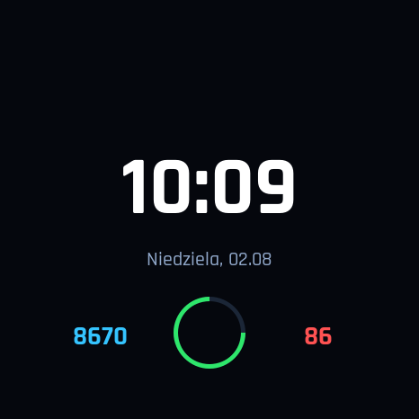

  

<h1 align="center">WatchFace Studio</h1>

  <strong>Graphical watch face editor — build, test, and export your watch face without writing code.</strong> 
  Amazfit Active 2 Round · 466×466 · Zepp OS 5

  
  
  
  
  
  
  

> [!WARNING]
> **Target device:** WatchFace Studio is built and tuned exclusively for the **Amazfit Active 2 Round (466×466)**. It has not been tested on other watches. Other Zepp OS models may work, but layout, fonts, hands, and text alignment are not guaranteed.

> [!NOTE]
> **Hobby project, iteratively created with AI assistance.** This is not a commercial, audited product. The code has been tested where possible, but always verify the watch face on your own watch before publishing it.

---

## ✨ What is WatchFace Studio?

WatchFace Studio is a desktop **WYSIWYG** editor for Zepp OS watch faces. Instead of writing `index.js` manually, you drag elements onto a 466×466 canvas, configure properties in the side panel, and immediately see the result. You can export the finished watch face into a `.zpk` developer package or a source ZIP used to create a watch face for everyday
