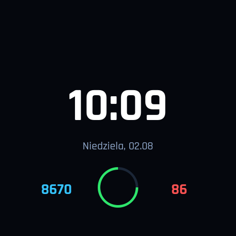
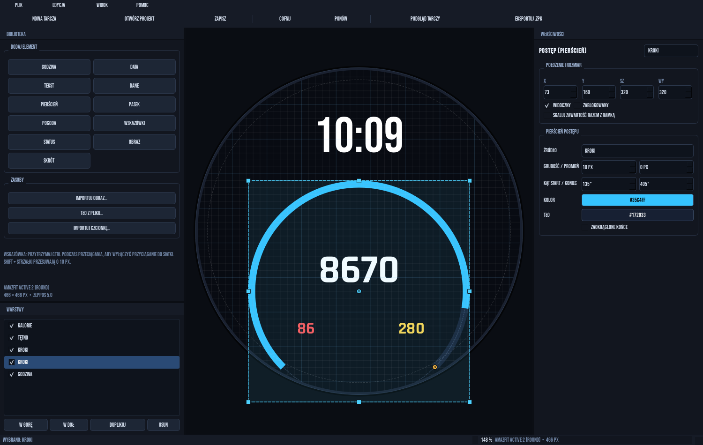
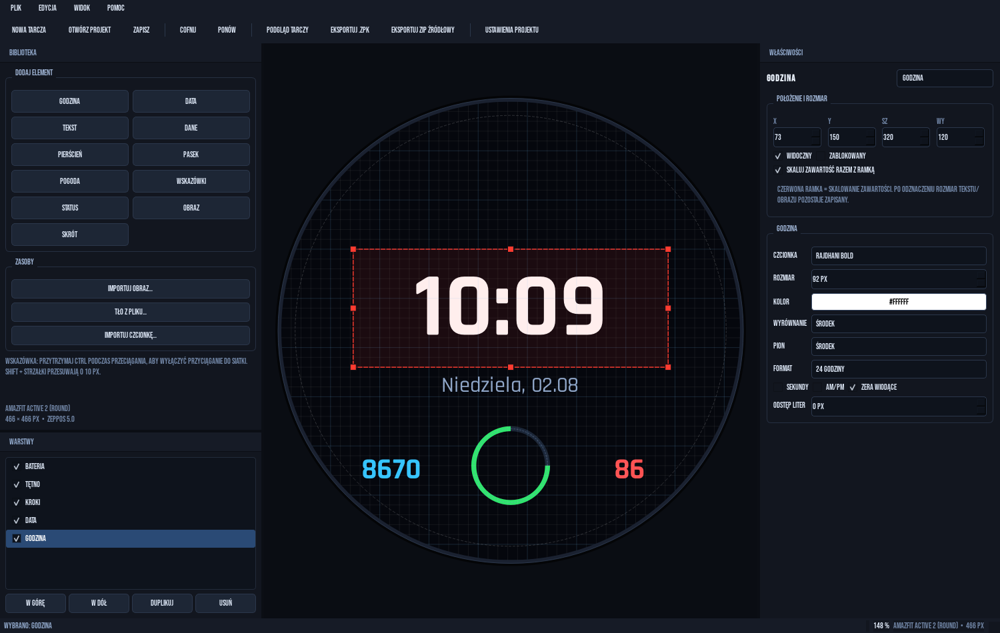

<p align="center">
  
</p>

<h1 align="center">WatchFace Studio</h1>

<p align="center">
  <strong>Edytor graficzny tarcz zegarka — złóż, sprawdź i wyeksportuj tarczę bez pisania kodu.</strong><br>
  Amazfit Active 2 Round · 466×466 · Zepp OS 5
</p>

<p align="center">
  
  
  
  
  
  
  
</p>

<p align="center">
  <sub>🇬🇧 <a href="README.md">English version</a></sub>
</p>

> [!WARNING]
> **Urządzenie docelowe:** WatchFace Studio jest zbudowany i dostrojony wyłącznie pod **Amazfit Active 2 Round (466×466)**. Nie był testowany na innych zegarkach. Inne modele Zepp OS mogą działać, ale układ, czcionki, wskazówki i wyrównanie tekstu nie są gwarantowane.

> [!NOTE]
> **Projekt hobbystyczny, tworzony iteracyjnie z pomocą AI.** To nie jest komercyjny, audytowany produkt. Kod był testowany tam, gdzie było to możliwe, ale przed publikacją tarczy zawsze sprawdź ją na własnym zegarku.

---

## ✨ Czym jest WatchFace Studio?

WatchFace Studio to desktopowy edytor **WYSIWYG** dla tarcz Zepp OS. Zamiast ręcznie pisać `index.js`, przeciągasz elementy na płótnie 466×466, ustawiasz właściwości w panelu obok i od razu widzisz wynik. Gotową tarczę eksportujesz do paczki deweloperskiej `.zpk` albo do ZIP źródłowego, z którego powstaje tarcza do codziennego użytku.

| | |
|---|---|
| 🖥️ Edytor | PySide6, ciemny interfejs, płótno 1:1 z ekranem zegarka |
| 🎛️ Elementy | 11 typów: tekst, dane, pogoda, wskazówki, pierścienie, skróty i inne |
| 👁️ Podgląd | Tryb `F5`, realistyczne dane przykładowe, eksport PNG i animowanego GIF |
| 📦 Eksport | `.zpk` do instalacji w trybie deweloperskim oraz ZIP źródłowy na amazfitwatchfaces |
| ⌚ Urządzenie | Amazfit Active 2 Round, 466×466, Zepp OS 5.0 / API 4.2 |
| 🧩 Projekt | Czytelny `project.json` + folder `assets/`, bez bazy danych i bez chmury |

---

## ⚡ Jak to działa w 30 sekund

1. 🚀 **Uruchom edytor** przez `run.bat` albo `python main.py`.
2. 🧱 **Wybierz szablon** — Cyfrowa, Minimal, Sportowa, Pogodowa lub Pusta — i dodaj potrzebne elementy.
3. 🎨 **Ułóż tarczę** na płótnie: przeciągaj, zmieniaj rozmiar uchwytami, ustawiaj właściwości i kolejność warstw.
4. 👁️ **Sprawdź podgląd** (`F5`), wylosuj dane przyciskiem **Losuj dane** i zapisz PNG lub GIF.
5. 📦 **Eksportuj** (`Ctrl+E` dla `.zpk`) albo wybierz **Eksportuj ZIP źródłowy**.

```text
project.json + assets/
        │
        ├──▶ render.py ──────▶ podgląd 466×466 · PNG / GIF
        │
        └──▶ codegen.py ─────▶ app.json · app.js · watchface/index.js · assets/
                    │
                    ▼
              exporter.py ─┬──▶ .zpk  (device.zip + app-side.zip, tryb preview)
                           └──▶ ZIP źródłowy (płaski, tryb production)
```

---

## 📸 Zrzuty ekranu

<p align="center">
  <br>
  <sub><strong>Edytor</strong> — płótno 466×466, biblioteka elementów, właściwości i warstwy w jednym oknie.</sub>
</p>

<table>
  <tr>
    <td align="center" width="50%">
      <br>
      <sub><strong>Szablon Cyfrowa</strong><br>Podgląd 466×466 z danymi przykładowymi</sub>
    </td>
    <td align="center" width="50%">
      <br>
      <sub><strong>Skalowanie zawartości</strong><br>Czerwona ramka = uchwyty skalują też treść</sub>
    </td>
  </tr>
</table>

> Zrzuty przedstawiają interfejs i dane demonstracyjne. Podgląd i `Preview.png` w paczce są generowane tym samym rendererem.

---

## 🚀 Szybki start

### Wymagania

- 🪟 Windows 10/11
- 🐍 Python 3.11+ (testowane na 3.15)
- 📦 `PySide6-Essentials` i `Pillow` z `requirements.txt`
- ⌚ Amazfit Active 2 Round do testów na urządzeniu

### Instalacja i uruchomienie

```powershell
cd sciezka\do\watchfaceeditor
python -m pip install -r requirements.txt
python main.py
```

Alternatywnie kliknij dwukrotnie **`run.bat`** — utworzy `.venv`, doinstaluje zależności, jeśli ich brakuje (pierwsze uruchomienie albo przerwana instalacja), i dopiero potem uruchomi edytor. Jeśli okno od razu się zamyka, uruchom `run.bat` z terminala, żeby zobaczyć komunikat, albo usuń folder `.venv` i spróbuj ponownie.

### Szybka kontrola jakości

```powershell
python -m pip install ruff
python -m ruff check wfeditor main.py tools
python -m compileall -q wfeditor main.py tools
```

`ruff` nie jest częścią zależności aplikacji — to opcjonalne narzędzie deweloperskie.

### Instalacja tarczy na zegarku

1. **`Ctrl+E`** tworzy plik `.zpk`. To paczka w trybie `preview` przeznaczona do testów i instalacji w trybie deweloperskim aplikacji Zepp.
2. Do instalacji potrzebujesz Zepp App **6.6.0+**, tego samego konta na telefonie i zegarku oraz zewnętrznego narzędzia lub kodu QR. **Edytor nie generuje kodu QR instalacji.**
3. **Docelowa tarcza** — widoczna na liście tarcz i usuwalna z zegarka — powstaje z **ZIP źródłowego** wgranego na [amazfitwatchfaces.com](https://amazfitwatchfaces.com/). Dopiero paczka zwrócona przez ten serwis jest przeznaczona do normalnej instalacji.

> [!IMPORTANT]
> `.zpk` z edytora nie jest podpisany ani przeznaczony do dystrybucji. Nie instaluj cudzych paczek `.zpk` — instaluj tylko własne buildy.

---

## 🧩 Funkcje

| Obszar | Co dostajesz |
|---|---|
| 🧱 Szablony | 5 punktów startowych: **Cyfrowa**, **Minimal**, **Sportowa**, **Pogodowa**, **Pusta** |
| 🧰 Elementy | 11 typów: godzina, data, tekst, dane, pierścień, pasek, ikona pogody, wskazówki, status, obraz, skrót |
| 🕰️ Wyświetlanie czasu | Wpisz wzorzec, np. `HH:MM:SS` — tylko godziny, tylko minuty albo dowolna kombinacja |
| 📊 Dane | 34 źródła w 4 grupach: Aktywność, Zdrowie, Pogoda, System |
| 🌤️ Pogoda | 29 wbudowanych ikon, własne zestawy (folder z 29 plikami PNG), temperatura, wilgotność, UV, AQI, ciśnienie, wschód i zachód słońca |
| 🕰️ Wskazówki | Godzinowa, minutowa, sekundowa i nakładka osi — każdą można podmienić osobno |
| ⭕ Postęp | Pierścień i pasek dla 10 źródeł: kroki, kalorie, dystans, tętno, bateria, PAI, stanie, stres, SpO₂, sen — z opcją wygięcia i obrazami 0%/100% |
| 🚀 Skróty | 61 aplikacji systemowych i sportowych otwieranych dotknięciem |
| 🔔 Status | Bluetooth, tryb Nie przeszkadzać, blokada i aktywny alarm |
| 🔤 Typografia | 7 wbudowanych fontów + import własnych TTF/OTF |
| 🖱️ Płótno | Przeciąganie, 8 uchwytów, uchwyt obrotu, siatka, przyciąganie, undo/redo, duplikowanie, warstwy i blokada |
| 📐 Skalowanie | Opcjonalne skalowanie treści razem z ramką, osobno dla każdego widgetu |
| 🎯 Środkowanie | Środkowanie w poziomie, w pionie albo w obu osiach z panelu właściwości lub menu kontekstowego |
| 🔄 Obrót | Obrót obrazów, stałego tekstu, ikon pogody, skrótów i wskazówek uchwytem w narożniku (Shift = co 15°) |
| 🎛️ Dane podglądu | Panel **Dane podglądu** w prawym dolnym rogu: losowanie, własne wartości, godzina i ikona pogody |
| ↔️ Wyrównanie | 9 ustawień tekstu (lewo/środek/prawo × góra/środek/dół); podgląd składa tekst tak jak zegarek — z metryk wiersza czcionki, z odstępem tylko między znakami i z ucinaniem wielokropkiem |
| 🖼️ Obrazy | Skalowanie w przestrzeni premultiplied alpha — bez białej obwódki i bez różnic edytor/urządzenie |
| 👁️ Podgląd | `F5`, losowe dane, zapis PNG oraz 24-klatkowego GIF-a |
| 📦 Eksport | `.zpk` dla trybu deweloperskiego i płaski ZIP źródłowy dla amazfitwatchfaces |
| 🗂️ Projekt | Nazwa, autor, appId (losowy dla każdego nowego projektu), wersja, tło, prosty ekran AOD, import obrazów i fontów |

### Wyświetlanie godziny

Element **Godzina** używa wzorca wyświetlania zamiast osobnych pól wyboru. Wpisujesz go w polu **Wyświetlanie**:

| Wzorzec | Wynik o 10:09:36 |
| --- | --- |
| `HH:MM` | `10:09` |
| `HH:MM:SS` | `10:09:36` |
| `HH` | `10` (tylko godziny) |
| `MM` | `09` (tylko minuty) |
| `H:M:S` | `10:9:36` (bez zera wiodącego) |
| `HH.MM` | `10.09` |
| `HH:MM A` | `10:09 AM` |

`HH`, `MM` i `SS` mają zero wiodące, a `H`, `M` i `S` nie mają. `A` dodaje AM/PM i działa z formatem 12-godzinnym. Każdy inny znak jest kopiowany dosłownie, więc separator wybierasz sam. Pusty lub niepoprawny wzorzec wraca do `HH:MM`. Projekty zapisane ze starym polem **Sekundy** są migrowane automatycznie.

### Wskazówki analogowe

Element **Wskazówki** rysuje cztery obrazy: godzinową, minutową, sekundową i nakładkę osi. Ramka wyznacza obszar, w którym mieszczą się wskazówki, a osią obrotu jest jej środek.

- Nowy element domyślnie zajmuje cały ekran `(0, 0, 466, 466)`.
- Przycisk **Dopasuj do tarczy** ustawia ramkę na pełny ekran — to najbezpieczniejszy wariant.
- Każda wskazówka ma własny wybór pliku. Wybrany plik ma pierwszeństwo przed zestawem, a **Domyślna** przywraca ustawienie zestawu.
- Możesz też zaimportować cały folder z `hour.png` i `minute.png` (opcjonalnie `second.png` i `cap.png`).
- Wbudowany zestaw to 4 obrazy 400×400 z osią obrotu w środku. Własne wskazówki powinny być skierowane do góry i mieć wspólne, kwadratowe płótno.
- Wbudowany zestaw z `assets/hands/` jest kopiowany do każdego nowego projektu. `tools/make_assets.py` zachowuje te pliki i odtwarza je tylko z flagą `--force`.
- Eksport zapisuje wskazówki jako standardowe widgety `IMG` z `pos_x`/`pos_y`, `center_x`/`center_y` i `angle` — nie jako `IMG_POINTER`, który na urządzeniu bywa ignorowany.
- Każdy eksportowany obraz wskazówki jest przycinany do widocznych pikseli z małym przezroczystym marginesem, a pierwotne położenie trafia do `pos_x`/`pos_y`. Pełnoekranowa tekstura 466×466 zajmuje po zdekodowaniu około 868 KB; cztery takie obrazy mogą przekroczyć pamięć zegarka i spowodować restart. Przycięte wskazówki zajmują zwykle 20–50 KB każda i wyglądają identycznie.

### Pierścień i pasek postępu

Pierścień ma na płótnie dwa punkty: środkowy zmienia **promień**, a punkt na łuku **grubość**. Przeciąganie w lewo lub w prawo aktualizuje wartości także w panelu właściwości.

- **Kąt start / koniec** wyznacza zakres łuku. Kąty liczone są zgodnie z ruchem wskazówek zegara od godziny 3, więc `0 → 360` to pełny okrąg, a `-10 → 190` zaczyna się tuż nad godziną 3 i biegnie przez godzinę 6 do tuż za godzinę 9. Eksport przelicza je na układ zegarka (przeciwnie do wskazówek, 0° = godzina 3), dzięki czemu własne kąty wyglądają na zegarku tak samo jak w edytorze.
- **Tło** to kolor niewypełnionej części łuku. Tło jest zawsze eksportowane z `level: 100`, więc pozostaje widoczne, gdy pierścień jest wypełniony tylko częściowo.
- **Pokaż tło** całkowicie ukrywa tło po odznaczeniu; kolor zostaje w projekcie, więc tło można przywrócić jednym kliknięciem.
- Sam postęp jest wysyłany do zegarka przez `hmUI.prop.LEVEL` — to samo wywołanie, którego używają prawdziwe tarcze — dzięki czemu łuk odświeża się niezawodnie.

Pasek postępu korzysta z tych samych 10 źródeł danych. Jego wygląd ustawia się w grupie **Pasek postępu**:

| Opcja | Znaczenie |
| --- | --- |
| **Wygląd** | **Kolor** (jednolity) albo **Obrazy 0% / 100%** (dwa obrazy). |
| **Orientacja** | **Poziomo** albo **Pionowo**. |
| **Kształt** | **Prosty** albo **Łuk**. |
| **Zakrzywienie** | 0–100% — jak mocno pasek się wygina; 0% to prosty pasek. |
| **Grubość** | Grubość łuku w px; `auto` wylicza ją z ramki. |
| **Wygięcie** | W górę/w dół dla poziomych, w lewo/w prawo dla pionowych. |
| **Zaokrąglone końce** | Zaokrąglone zakończenia łuku. |
| **Wypełnianie** | **Od początku** (lewa/dół) albo **Od końca** (prawa/góra). |
| **Pokaż tło** | Pokazuje tło częściowo wypełnionego paska; odznacz, aby je ukryć (kolor zostaje zapisany). |

Przy **Obrazy 0% / 100%** oba obrazy są skalowane do ramki paska. Obraz 0% jest tłem, a obraz 100% jest odsłaniany stopniowo wraz z postępem:

- prosty pasek przycina obraz 100% przez `pos_x`/`pos_y`,
- wygięty pasek używa 51 wcześniej wyrenderowanych klatek (`PROGRESS_BAR_FRAMES`) podmienianych przez `hmUI.prop.SRC`, więc zegarek pokazuje dokładnie ten sam obraz co edytor.

Geometria łuku (środek, promień, kąty) pochodzi z jednej wspólnej funkcji (`bar_arc_geometry`) używanej przez edytor, podgląd, klatki i wygenerowany `index.js`. Łuk jest dopasowany tak, aby całe pasmo — razem z zaokrąglonymi końcami — mieściło się w ramce elementu.

### Skalowanie zawartości

Opcja **Skaluj zawartość razem z ramką** działa per element:

- ✅ zaznaczona — ramka jest **czerwona**, a uchwyty zmieniają rozmiar tekstu lub obrazu; eksport dostaje te same wartości,
- ⬜ odznaczona — zmienia się tylko obszar widgetu, a zapisany rozmiar tekstu/obrazu pozostaje bez zmian.

Skalowanie tekstu używa jednego współczynnika dla obu osi, więc litery nie są rozciągane. Podgląd składa tekst tak jak zegarek: wyrównanie pionowe liczy z metryk wiersza czcionki, odstęp liter dodaje tylko między znakami, a tekst szerszy niż ramka ucina wielokropkiem. Wygenerowany `index.js` dostaje te same ustawienia wyrównania, odstępu i ucinania.

### Środkowanie i obrót

- Przyciski **Wyśrodkuj** w panelu właściwości ustawiają element dokładnie na środku tarczy: **Poziomo**, **Pionowo** albo **Oba**. Te same opcje są w menu kontekstowym płótna pod **Wyśrodkuj na tarczy**.
- Kreskowany uchwyt po skosie za prawym górnym narożnikiem zaznaczonego elementu obraca go. Przytrzymaj **Shift**, aby przyciągać do wielokrotności 15°; aktualny kąt pokazuje pole **Obrót** w panelu właściwości oraz etykieta obok uchwytu.
- Obrót jest dostępny dla **obrazów, stałego tekstu, ikon pogody, skrótów i wskazówek**.
- Zepp OS nie obraca widgetów `TEXT`, dlatego stały tekst z obrotem jest eksportowany jako PNG (`txt_*.png`) i widget `IMG` z `angle` — zegarek pokazuje dokładnie to samo co edytor.
- Tekstu dynamicznego (godzina, data, dane) nie można obracać; panel właściwości pokazuje wtedy podpowiedź zamiast pola kąta.
- Projekty zapisane starszą wersją trzymały kąt obrazu w `props["angle"]`; jest on automatycznie przenoszony do wspólnego pola obrotu.
- Obrócony element nadal można zaznaczyć, klikając jego widoczną (obróconą) treść.

### Panel danych podglądu

Panel **Dane podglądu** w prawym dolnym rogu steruje tym, co pokazuje płótno bez zegarka:

- **Losuj dane** wypełnia wszystkie pola danych, godzinę i ikonę pogody losowymi wartościami — płótno od razu się aktualizuje.
- **Wyczyść** przywraca domyślne wartości przykładowe.
- **Godzina** nadpisuje czas używany przez podgląd; puste pole (czyli `00:00:00`) oznacza brak nadpisania.
- **Ikona pogody** wybiera jedną z 29 wbudowanych ikon.
- **Własne wartości** pokazuje tylko źródła danych używane w projekcie. Wpisz np. `8670`, `5,3 km` albo `07:32`, a wartość pojawi się na płótnie.
- Te same wartości trafiają do okna podglądu `F5`. Panel można ukryć w menu **Widok**.

### Fonty i polskie znaki

Edytor rejestruje dokładny plik czcionki, odczytuje z niego rodzinę, styl i wagę przez `QRawFont` i rysuje tekst wskazanym krojem. Dzięki temu **Regular**, **Medium** i **Bold** wyglądają tak samo w edytorze, podglądzie i na zegarku. Wbudowane fonty mają pełny zestaw polskich znaków; przy imporcie własnego TTF/OTF sprawdź, czy zawiera wymagane glify.

---

## 🧠 Jak to działa?

Edytor jest podzielony na warstwy: model projektu, renderer, generator kodu i eksporter. Każda z nich korzysta z tych samych danych wejściowych, więc podgląd i paczka nie rozjeżdżają się.

### 1. Model projektu

`wfeditor/model.py` przechowuje `Project` i `Element` jako dataclasses. Projekt zapisuje się do `project.json`, a obrazy i fonty do `assets/`. Historia zmian (undo/redo) żyje tylko w pamięci — nie jest zapisywana do pliku.

Nowa, niezapisana tarcza trafia tymczasowo do `%TEMP%\WatchFaceStudio\projects`. Przy **Zapisz jako** edytor proponuje katalog `projects/` w repo, ale możesz wybrać dowolne miejsce. Katalog `projects/` jest ignorowany przez git.

### 2. Renderer

`wfeditor/render.py` rysuje tarczę przez `QPainter` w logicznym układzie 466×466. Ten sam renderer obsługuje:

- płótno edytora i podgląd `F5`,
- obraz `Preview.png` w paczce,
- eksport PNG i animacji GIF.

Podgląd skaluje całość z zachowaniem proporcji, a nie poszczególne elementy — dlatego układ jest identyczny niezależnie od rozmiaru okna. Renderer obsługuje też dane przykładowe, losowanie wartości i podmianę ikony pogody.

### 3. Generator kodu

`wfeditor/codegen.py` zamienia projekt na pliki Zepp OS:

- `app.json` — konfiguracja urządzenia, `designWidth`, uprawnienia i `packageInfo`,
- `app.js` — bootstrap aplikacji,
- `watchface/index.js` — widgety, sensory, timer pogody, wskazówki i logika AOD.

Uprawnienie `gps` jest dodawane tylko wtedy, gdy tarcza używa pogody: ikony pogody albo danych z grupy Pogoda (miasto, temperatura, wilgotność itd.). Generator nie dodaje uprawnień sieciowych.

### 4. Zasoby

`wfeditor/resources.py` planuje, co trafi do `device/assets/`: obrazy elementów, ikony pogody i statusu, fonty oraz zasoby wskazówek. Nazwy plików są generowane na podstawie źródła i rozmiaru, więc eksport jest powtarzalny. Ikony skrótów dostają wspólny przezroczysty `empty.png`, gdy jest potrzebny.

### 5. Obrazy i alpha

`wfeditor/imaging.py` ładuje, skaluje i zapisuje obrazy w przestrzeni **premultiplied alpha**. Zmniejszanie korzysta z łańcucha mipmap (bez aliasingu), a powiększanie z resamplingu sharp-bilinear (całkowite powiększenie najbliższym sąsiadem, potem gładkie dopasowanie). Żadna z metod nie miesza koloru z przezroczystym tłem, więc na krawędziach nie pojawia się biała obwódka, a szczegóły pozostają ostre. Ten sam pipeline jest używany w edytorze i przy budowaniu paczki.

### 6. Eksporter

`wfeditor/exporter.py` buduje drzewo `device/`, a następnie:

- **`.zpk`** — pakuje `device.zip` i `app-side.zip`, ustawia `mode: "preview"` i `lockscreen: 1`,
- **ZIP źródłowy** — pakuje zawartość `device/` bez podkatalogu, ustawia `mode: "production"` i `lockscreen: 0`.

Oba warianty zawierają `Preview.png` o rozmiarze 314×314, czyli takim, jakiego oczekuje lista tarcz.

---

## 📦 Co trafia do eksportu

| | `.zpk` (dev) | ZIP źródłowy |
|---|---|---|
| Przeznaczenie | Testy i instalacja w trybie deweloperskim | amazfitwatchfaces → tarcza produkcyjna |
| Układ | `device.zip` + `app-side.zip` | Płaska zawartość `device/` (bez podkatalogu) |
| `app.json` | `mode: "preview"`, `lockscreen: 1` | `mode: "production"`, `lockscreen: 0` |
| Platforma | `Amazfit Active 2` | `Amazfit Active 2` |
| `watchface/index.js` | ✅ | ✅ |
| Obrazy i fonty | ✅ | ✅ |
| `Preview.png` 314×314 | ✅ | ✅ |
| `app-side/app.json` | ✅ | ❌ |
| Pogoda / GPS | tylko gdy użyto pogody | tylko gdy użyto pogody |

---

## ⌨️ Skróty klawiszowe

| Skrót | Działanie |
|---|---|
| `Ctrl+N` | Nowa tarcza |
| `Ctrl+O` | Otwórz projekt |
| `Ctrl+S` | Zapisz |
| `Ctrl+Shift+S` | Zapisz jako |
| `Ctrl+E` | Eksportuj `.zpk` |
| `F5` | Podgląd tarczy |
| `Ctrl+Z` / `Ctrl+Y` | Cofnij / ponów |
| `Ctrl+D` | Duplikuj element |
| `Delete` | Usuń zaznaczony element |
| `Shift` + strzałki | Przesuń o 10 px |
| `Ctrl` + przeciąganie | Przejściowo wyłącz przyciąganie do siatki |

---

## 🧰 Technologie

| Warstwa | Technologia | Rola |
|---|---|---|
| Język | Python 3.11+ | Logika edytora i eksportu |
| Interfejs | PySide6-Essentials / Qt 6 | Okna, panele, płótno, dialogi |
| Render | `QPainter`, `QRawFont` | Podgląd, tekst, wskazówki, pierścienie |
| Obrazy | Pillow + Qt | Skalowanie premultiplied alpha, PNG, GIF |
| Model | JSON + dataclasses | `project.json`, elementy, ustawienia |
| Eksport | `zipfile`, `tempfile` | `.zpk` i ZIP źródłowy |
| Platforma | Zepp OS 5 / API 4.2 | `hmUI`, `hmSensor`, `DeviceRuntimeCore.WatchFace` |
| Testy | Zewnętrzny harness Node + skrypty PySide6 | Runtime `index.js`, UI, render, eksport (poza repo) |

---

## 🗂️ Struktura repozytorium

```text
.
├── main.py                      # punkt wejścia aplikacji
├── run.bat                      # Windows: venv + zależności + start
├── requirements.txt             # PySide6-Essentials, Pillow
├── README.md                    # angielska wersja README
├── README.pl.md                 # polska wersja README
├── images/                      # zrzuty ekranu do README
├── assets/
│   ├── fonts/                   # 7 wbudowanych fontów TTF
│   ├── hands/                   # hour/minute/second/cap 400×400
│   ├── status/                  # ikony Bluetooth, DND, blokady, alarmu
│   └── weather/                 # 29 ikon pogody
├── tools/
│   └── make_assets.py           # generator zasobów wbudowanych
├── wfeditor/
│   ├── main.py                  # QApplication, motyw, pierwszy projekt
│   ├── constants.py             # urządzenie, dane, pogoda, skróty, fonty
│   ├── model.py                 # Project, Element, szablony, import zasobów
│   ├── timeformat.py            # parser i renderer wzorca HH:MM:SS
│   ├── render.py                # podgląd, tekst, wskazówki, GIF
│   ├── codegen.py               # app.json, app.js, watchface/index.js
│   ├── resources.py             # plan zasobów do paczki
│   ├── imaging.py               # premultiplied alpha
│   ├── exporter.py              # .zpk i ZIP źródłowy
│   ├── templates/
│   │   └── app.js               # bootstrap Zepp OS
│   └── ui/
│       ├── mainwindow.py        # menu, paski, eksport, skróty
│       ├── canvas.py            # płótno, uchwyty, siatka, pierścień
│       ├── inspector.py         # właściwości elementów
│       ├── layers.py            # lista warstw
│       ├── palette.py           # dodawanie elementów i zasobów
│       ├── dialogs.py           # nowy projekt, ustawienia, podgląd
│       └── theme.py             # ciemny motyw Qt
├── projects/                    # projekty użytkownika (gitignored)
└── .gitignore
```

---

## 🧪 Testy

W repozytorium **nie ma katalogu testów** — w trakcie prac korzystałem z zewnętrznego harnessu i skryptów uruchamianych w `%TEMP%`. Nie są one częścią repozytorium, więc poniższe wyniki opisują ostatni stan prac, a nie gotowy pipeline CI.

```powershell
python -m ruff check wfeditor main.py tools
python -m compileall -q wfeditor main.py tools
```

Sprawdzone obszary:

- ✅ **33/33** kontroli harnessu Node uruchamiającego wygenerowany `index.js`: pogoda, wskazówki, fonty i istnienie zasobów,
- ✅ struktura i manifesty `app.json`/`app.js` oraz paczek `.zpk` i ZIP źródłowego,
- ✅ szablony, dodawanie i duplikowanie elementów, warstwy, undo/redo,
- ✅ wskazówki: wybór per rola, priorytet pliku nad zestawem, „Domyślna”, dopasowanie do tarczy,
- ✅ pierścień: przeciąganie promienia i grubości, synchronizacja z polami,
- ✅ skalowanie zawartości i eksport tych samych wartości,
- ✅ wyrównanie tekstu 3×3, polskie znaki, Regular/Medium/Bold,
- ✅ wzorce czasu: `HH`, `MM`, `HH:MM`, `HH:MM:SS`, `H:M:S`, `HH.MM`, `HH:MM A`, 12/24 h, migracja starych pól `seconds`/`ampm`/`pad` i identyczny wynik w edytorze i eksporcie,
- ✅ losowy `appId` dla każdego nowego projektu,
- ✅ dwa elementy pogody z tym samym i różnymi zestawami ikon,
- ✅ podgląd PNG/GIF z losowymi danymi,
- ✅ struktura `.zpk`, tryb `preview`, `lockscreen: 1`, assety wskazówek przycięte do widocznej treści, `center_x: 233`, brak `IMG_POINTER`,
- ✅ ZIP źródłowy: płaski układ, `mode: "production"`, platforma `Amazfit Active 2`.

Czego **nie** ma:

- ❌ CI i testów w repozytorium,
- ❌ testów regresji wizualnej,
- ❌ pełnego potwierdzenia na fizycznym zegarku: ruch wskazówek, pozycja na liście tarcz, ikona kosza i pełna zgodność wyrównania,
- ❌ testów na innych modelach zegarków.

---

## 🛠️ Ograniczenia i świadome kompromisy

1. **Jedno urządzenie.** Cały układ jest projektowany pod 466×466. `designWidth` jest stały, a inne rozdzielczości wymagają osobnych profili i testów.
2. **Brak cyfr obrazkowych.** Godzina i data są rysowane fontem, nie zestawem obrazków `0–9`. To upraszcza edytor, ale ogranicza stylizację.
3. **Uproszczony AOD.** Ustawienia projektu pozwalają wybrać kolor i godzinę dla ekranu zawsze włączonego; to nie jest pełny, niezależny układ AOD.
4. **Pogoda przed synchronizacją.** Nazwa miasta pokazuje `--`, a ikona wariant „nieznana”, dopóki zegarek nie pobierze danych.
5. **Wskazówki wymagają dobrze ustawionej ramki.** Obrót liczy się względem środka ramki, a zestaw jest skalowany do jej wnętrza. Ramka powinna być kwadratowa i wyśrodkowana na tarczy; inaczej wskazówki będą mniejsze lub oś nie pokryje się z tarczą — używaj **Dopasuj do tarczy**.
6. **Własne fonty mogą nie mieć polskich znaków.** Edytor ostrzega, ale nie naprawia brakujących glifów.
7. **`.zpk` to tryb deweloperski.** Docelowa, usuwalna tarcza powstaje dopiero z ZIP źródłowego na amazfitwatchfaces.
8. **Nie wszystko potwierdzone na sprzęcie.** Wskazówki jako `IMG`, poprawki listy tarcz i ikony kosza oraz wyrównanie tekstu zostały sprawdzone w kodzie, podglądzie i wyeksportowanych plikach — ale nie każdy z tych elementów został potwierdzony na fizycznym zegarku.
9. **Testy poza repo, brak CI.** Jakość opiera się na harnessie, skryptach tymczasowych i kontrolach ręcznych, nie na powtarzalnym pipeline.
10. **Brak pliku `LICENSE`.** Przed publikacją jako open source dodaj wybraną licencję.

---

## 🔒 Bezpieczeństwo i prywatność

- 🚫 Aplikacja desktopowa nie wysyła danych do sieci i nie zawiera telemetrii.
- 💾 Projekty, obrazy i fonty zostają lokalnie — w `project.json` i `assets/`.
- 🔐 W repo nie ma kont, tokenów ani danych logowania Zepp/Amazfit.
- 📡 Wygenerowany `app.json` nie dodaje uprawnień sieciowych. Jedyne warunkowe uprawnienie to `gps`, potrzebne do pogody: ikony lub danych pogodowych.
- ⚠️ **Paczki `.zpk` nie są podpisane.** Instaluj tylko własne buildy i tylko w trybie deweloperskim.
- 🧪 Importowane obrazy i fonty są kopiowane do projektu — przed importem upewnij się, że pochodzą z zaufanego źródła.

---

## 🗺️ Roadmap

- [ ] Potwierdzić na fizycznym zegarku ruch wskazówek, listę tarcz, ikonę kosza i wyrównanie tekstu
- [ ] Dodać testy do repozytorium i prosty CI
- [ ] Dodać profil innego zegarka dopiero po testach na sprzęcie
- [ ] Dodać pełny, niezależny układ AOD
- [ ] Dodać cyfry obrazkowe
- [ ] Dodać więcej zestawów wskazówek i ikon pogody
- [ ] Dodać krótkie demo GIF do README
- [ ] Dodać plik `LICENSE`

---

## 📄 Licencja

W repozytorium nie ma pliku `LICENSE`. Jeśli chcesz udostępnić projekt jako open source, dodaj wybraną licencję — na przykład MIT.

---

## 🙏 Podziękowania

- [Qt for Python / PySide6](https://doc.qt.io/qtforpython/) — interfejs i renderer
- [Pillow](https://python-pillow.org/) — obrazy i GIF
- [Zepp OS Developers Documentation](https://docs.zepp.com/) — API tarcz i urządzeń
- Społeczność [amazfitwatchfaces.com](https://amazfitwatchfaces.com/) — format paczek i publikacja tarcz
- Wbudowane fonty: Rajdhani, Chakra Petch, Michroma, Bebas Neue
- AI jako partner w iteracyjnym tworzeniu projektu

---

## ⚠️ Disclaimer

Projekt hobbystyczny, niepowiązany z Zepp Health ani Amazfit. Zbudowany wyłącznie pod **Amazfit Active 2 Round (466×466)** i nietestowany na innych zegarkach. Używaj na własne ryzyko. Przed publikacją lub codziennym użytkowaniem tarczy sprawdź jej wygląd, działanie wskazówek i instalację na własnym urządzeniu.
